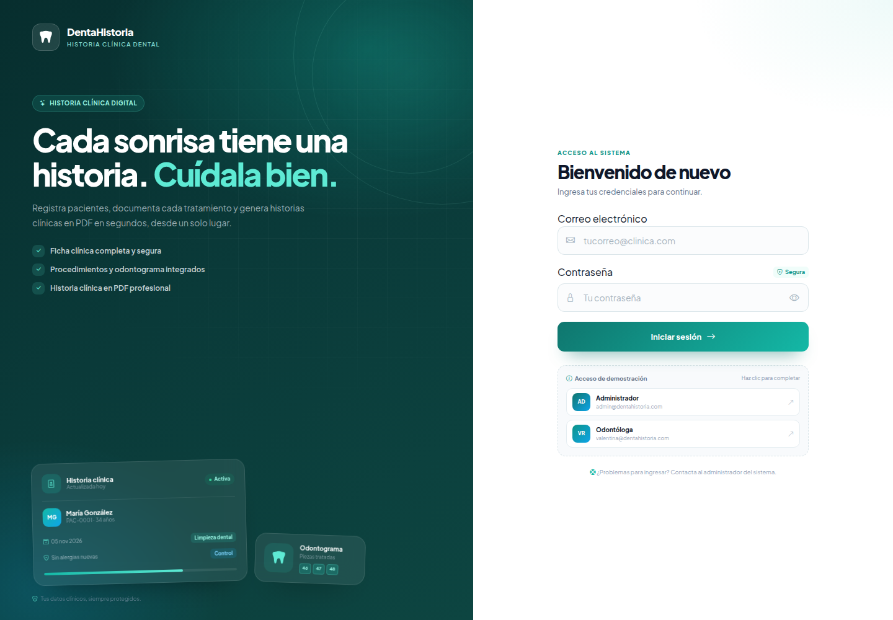
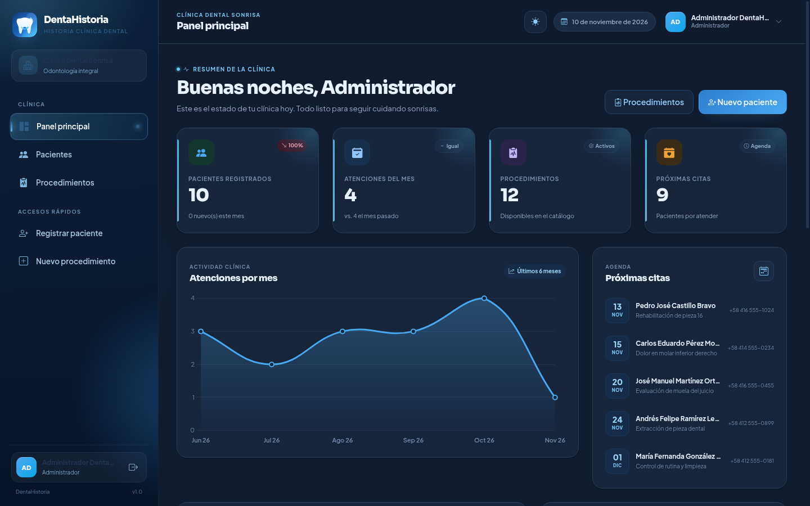
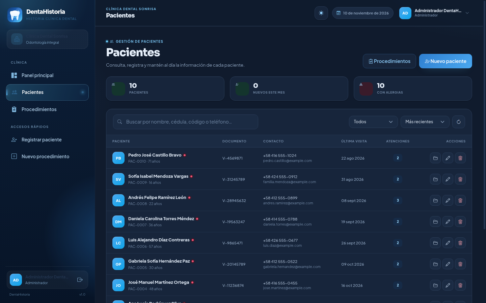
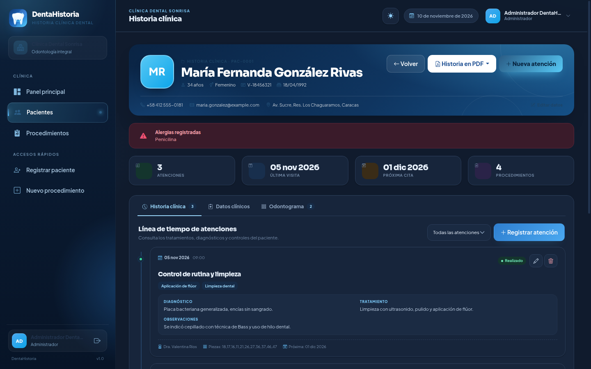
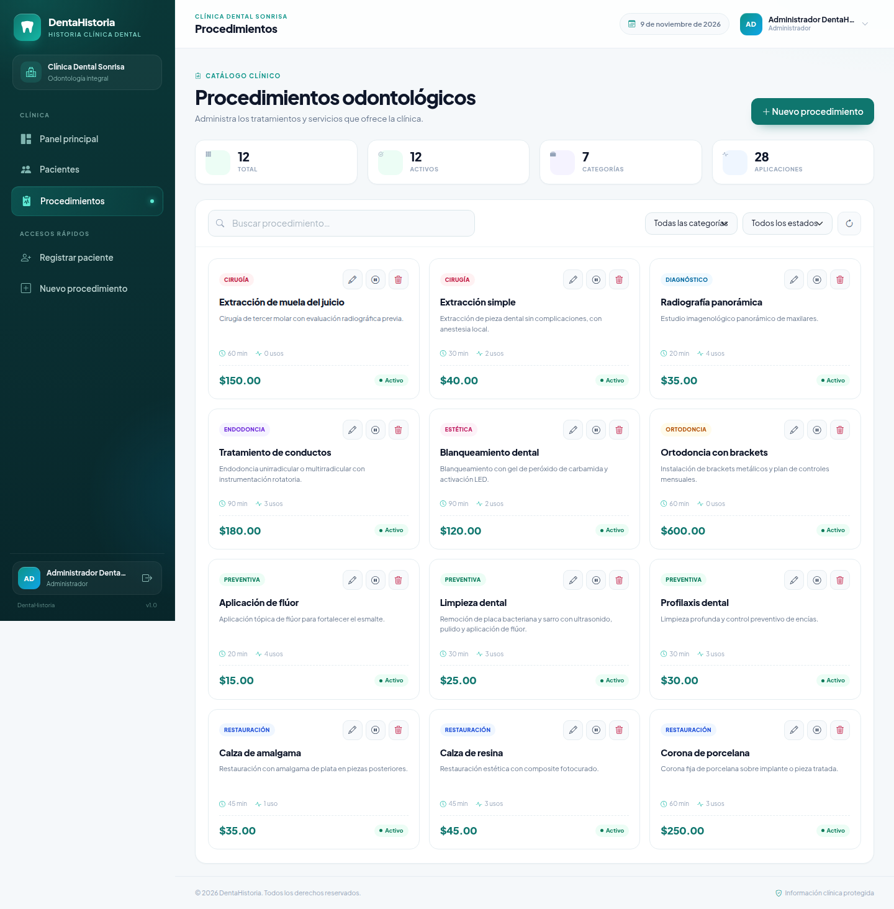

# DentaHistoria

Sistema web para la gestión de la historia clínica de una consulta odontológica. Permite registrar pacientes, mantener su historial de atenciones, administrar el catálogo de procedimientos y generar la historia clínica en PDF.

Proyecto académico desarrollado con **PHP, MySQL, AJAX y Bootstrap 5**, sin frameworks ni dependencias externas de Composer.



## Demo en vivo

- **Aplicación publicada:** [https://dentahistoria.kesug.com](https://dentahistoria.kesug.com)
- **Repositorio:** [github.com/YariBelandria/DentaHistoria](https://github.com/YariBelandria/DentaHistoria)

El registro de nuevas cuentas está habilitado y protegido con el código de invitación `DENTA-2026`.

## Funcionalidades

- **Autenticación con sesiones**: inicio y cierre de sesión, contraseñas con `password_hash`, protección CSRF y límite básico de intentos.
- **Registro de usuarios**: cada persona crea su cuenta con su propio correo y contraseña. El registro se protege con un código de invitación configurable.
- **Panel principal**: indicadores de pacientes, atenciones del mes, procedimientos activos y próximas citas; gráficos de actividad y distribución por especialidad.
- **Gestión de pacientes**: registro, edición, búsqueda, filtros, paginación y eliminación (solo administrador). Cada paciente recibe un código `PAC-XXXX`.
- **Historia clínica**: línea de tiempo de atenciones con fecha, hora, motivo, diagnóstico, tratamiento, observaciones, estado, piezas dentales y próximas citas.
- **Odontograma**: mapa interactivo de las 32 piezas permanentes (numeración FDI) con estado por pieza, notas clínicas y actualización AJAX. También se incluye en el PDF.
- **Catálogo de procedimientos**: alta, edición, activación/desactivación y eliminación segura (si tiene atenciones asociadas solo se desactiva).
- **Historia clínica en PDF**: documento profesional generado en el servidor con FPDF, con datos del paciente, alergias, antecedentes, resumen y detalle de cada atención.
- **Diseño responsive**: interfaz adaptada a escritorio, tablet y móvil; Bootstrap 5.3, Bootstrap Icons y tipografía Plus Jakarta Sans.
- **Auditoría**: registro de acciones relevantes (crear, actualizar, eliminar, iniciar/cerrar sesión).

## Tecnologías

| Capa | Tecnología |
| --- | --- |
| Servidor | PHP 8.2–8.4 (probado en PHP 8.4) |
| Base de datos | MySQL 5.7+ / MariaDB 10.3+ |
| Acceso a datos | PDO con consultas preparadas |
| Frontend | Bootstrap 5.3.3, Bootstrap Icons, CSS propio |
| Interactividad | JavaScript nativo + `fetch` (AJAX) |
| Gráficos | Chart.js 4 |
| PDF | FPDF 1.9 (incluida en `vendor/`) |

## Acceso de demostración

| Rol | Correo | Contraseña |
| --- | --- | --- |
| Administrador | `admin@dentahistoria.com` | `Admin123!` |
| Odontóloga | `valentina@dentahistoria.com` | `Odonto2026!` |

> Cambia estas credenciales antes de usar el sistema con datos reales.

También puedes crear una cuenta propia desde `registro.php`. El formulario pide nombre, correo, contraseña y el código de invitación configurado en `includes/config.local.php` (por defecto `DENTA-2026`). Así el profesor o cualquier odontólogo entra con su propio correo y su propia contraseña, sin compartir una cuenta genérica.

Para cambiar el código de invitación, edita `includes/config.local.php`:

```php
'app' => [
    'registration' => [
        'enabled' => true,
        'code'    => 'TU-CODIGO-PRIVADO',
    ],
],
```

## Estructura del proyecto

```text
DentaHistoria/
├── api/                  Endpoints AJAX (auth, dashboard, pacientes, atenciones, procedimientos, odontograma)
├── assets/
│   ├── css/app.css       Estilos de toda la aplicación
│   ├── img/              Logotipo y favicon
│   └── js/               Lógica AJAX por pantalla
├── database/
│   ├── schema.sql        Creación de tablas
│   ├── seed.sql          Datos de demostración
│   └── instalacion-completa.sql  Esquema + datos en un solo archivo
├── docs/                 Manual de usuario, documentación técnica y capturas
├── includes/
│   ├── auth.php          Sesiones y permisos
│   ├── bootstrap.php     Arranque común
│   ├── compat.php        Respaldo si falta mbstring
│   ├── config.php        Configuración general
│   ├── csrf.php          Tokens CSRF
│   ├── database.php      Conexión PDO
│   ├── functions.php     Utilidades compartidas
│   └── layout/           Cabecera y pie común
├── pdf/historia.php      Generación del PDF
├── vendor/fpdf/          Librería FPDF 1.9
├── index.php             Inicio de sesión
├── registro.php          Registro de nuevas cuentas
├── dashboard.php         Panel principal
├── pacientes.php         Listado y formulario de pacientes
├── paciente.php          Historia clínica del paciente
├── procedimientos.php    Catálogo de procedimientos
└── logout.php            Cierre de sesión
```

## Ejecución local

### 1. Requisitos

- PHP 8.0 o superior con `pdo_mysql`.
- MySQL o MariaDB en ejecución.
- Un servidor web (Apache, Nginx, XAMPP, Laragon, WAMP) o el servidor integrado de PHP.

### 2. Crear la base de datos

```bash
mysql -u root -p -e "CREATE DATABASE dentahistoria CHARACTER SET utf8mb4 COLLATE utf8mb4_unicode_ci;"
mysql -u root -p dentahistoria < database/schema.sql
mysql -u root -p dentahistoria < database/seed.sql
```

`seed.sql` es opcional: solo agrega los usuarios y datos de demostración.

### 3. Configurar la conexión

Copia el archivo de ejemplo y ajusta los datos:

```bash
cp includes/config.local.example.php includes/config.local.php
```

Edita `includes/config.local.php` con el host, nombre, usuario y contraseña de tu MySQL. Ese archivo está excluido de Git.

También puedes usar variables de entorno:

```bash
export DB_HOST=127.0.0.1
export DB_PORT=3306
export DB_NAME=dentahistoria
export DB_USER=tu_usuario
export DB_PASS=tu_contraseña
```

### 4. Levantar la aplicación

Con Apache/XAMPP, coloca el proyecto dentro de `htdocs` y abre `http://localhost/DentaHistoria/`.

Con el servidor integrado de PHP:

```bash
php -S localhost:8000 -t .
```

Luego abre `http://localhost:8000/` e inicia sesión con las credenciales de demostración.

## Despliegue gratuito en InfinityFree

InfinityFree ofrece hospedaje PHP + MySQL sin costo. Estos son los pasos:

1. Crea una cuenta en [infinityfree.com](https://www.infinityfree.com/) y un *hosting account* con un subdominio gratuito (por ejemplo `dentahistoria.infinityfreeapp.com`).
2. En el panel de control abre **MySQL Databases** y crea una base de datos. Anota:
   - **MySQL Host** (normalmente `sqlXXX.infinityfree.com`, no `localhost`),
   - **Database Name** (suele iniciar con `if0_`),
   - **Username** y **Password**. En InfinityFree la contraseña de MySQL es la misma de la **cuenta de hosting** (Panel de Control / FTP), no la de `dash.infinityfree.com`.
3. Abre **phpMyAdmin** desde el panel, selecciona la base de datos e importa `database/instalacion-completa.sql`. Ese archivo crea las 7 tablas y carga los datos de demostración en un solo paso. Si prefieres hacerlo por separado, importa primero `database/schema.sql` y después `database/seed.sql`.
4. Sube todos los archivos del proyecto a la carpeta `htdocs` usando el **File Manager** o un cliente FTP (FileZilla). Mantén la estructura de carpetas.
5. Crea en el servidor el archivo `includes/config.local.php` con los datos reales de tu base de datos (puedes copiar `includes/config.local.example.php` y editarlo desde el File Manager). Ajusta también `app.registration.code` con un código privado y compártelo solo con las personas que deben registrarse.
6. Verifica que la versión de PHP sea 8.3 o 8.4 en **PHP Configuration** y que estén activas las extensiones `pdo_mysql`, `mbstring` e `iconv`.
7. Abre tu subdominio. La pantalla de inicio de sesión debe aparecer; prueba con el usuario administrador.
8. Si vas a usar datos reales, cambia las contraseñas de demostración y elimina los pacientes de ejemplo.

> **Importante:** nunca subas `includes/config.local.php` a GitHub. Ya está incluido en `.gitignore`.

### Solución de problemas frecuentes

| Síntoma | Causa probable | Solución |
| --- | --- | --- |
| “No se pudo conectar con la base de datos” | Datos incorrectos o host `localhost` | Usa el host MySQL que muestra InfinityFree |
| Error 500 al abrir la app | Versión de PHP o `.htaccess` incompatible | Cambia a PHP 8.3/8.4 y revisa los logs |
| El PDF no descarga | Falta la carpeta `vendor/fpdf/font` | Sube la carpeta completa `vendor/fpdf/` |
| No aparecen los estilos | Ruta base incorrecta | Sube el contenido a `htdocs` respetando carpetas |

## Seguridad implementada

- Contraseñas almacenadas con `password_hash` (bcrypt).
- Consultas preparadas en todas las operaciones con base de datos.
- Escape HTML en las vistas y en el JavaScript que inserta datos.
- Tokens CSRF en formularios y peticiones AJAX (`X-CSRF-Token`).
- Cookies de sesión `HttpOnly`, `SameSite=Lax` y `Secure` cuando hay HTTPS.
- Control de permisos: solo el rol administrador puede eliminar pacientes; cada odontólogo edita sus propias atenciones.
- `.htaccess` bloquea el acceso directo a `includes/`, `database/` y `vendor/`.
- Registro de auditoría de las acciones principales.

## Documentación

- [Manual de usuario](docs/MANUAL-USUARIO.md)
- [Documentación técnica](docs/DOCUMENTACION-TECNICA.md)

## Capturas

| Panel principal | Pacientes |
| --- | --- |
|  |  |

| Historia clínica | Procedimientos |
| --- | --- |
|  |  |

## Autor

Proyecto desarrollado por **Yari Belandria** como parte de un trabajo académico de desarrollo web.

- GitHub: [@YariBelandria](https://github.com/YariBelandria)
- Repositorio: [YariBelandria/DentaHistoria](https://github.com/YariBelandria/DentaHistoria)

## Licencia

Código liberado bajo licencia MIT. La librería FPDF conserva su propia licencia incluida en `vendor/fpdf/license.txt`.
